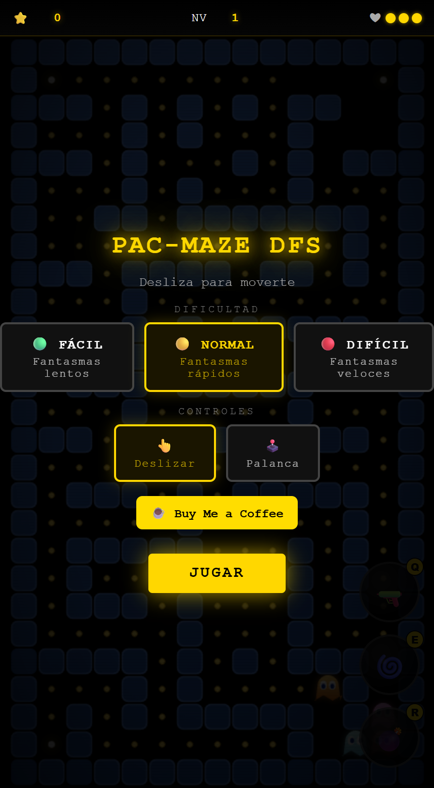
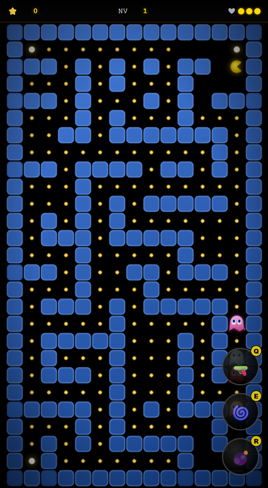
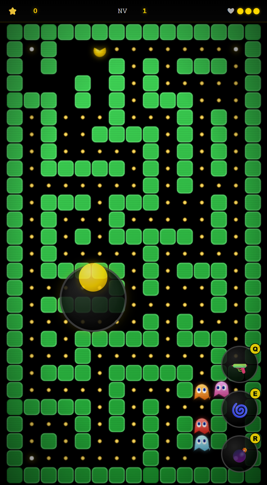

# PAC-MAZE DFS

Juego arcade de persecución en laberintos para navegador. Cada nivel genera un laberinto aleatorio nuevo con búsqueda en profundidad (DFS).

**[▶ Jugar ahora](https://gabom88.github.io/Pac-Maze-DFS/)**

| Menú | Partida | Palanca |
|:---:|:---:|:---:|
|  |  |  |

## Cómo jugar

Recoge todos los puntos del laberinto para pasar de nivel y evita a los cuatro fantasmas. Empiezas con 3 vidas.

| Elemento | Efecto |
|---|---|
| Punto | 10 puntos |
| Punto grande | 50 puntos; durante 6 segundos puedes comerte a los fantasmas |
| Fantasma eliminado | 200 puntos |
| Vida extra | Al sumar cada 2500 de puntuación y al comer cada 150 puntos |

### Controles

| Acción | Teclado | Pantalla táctil | Ratón |
|---|---|---|---|
| Moverse | Flechas o `W` `A` `S` `D` | Deslizar, o palanca | Palanca |
| Láser | `Q` | Botón 🔫 | Botón 🔫 |
| Teletransporte | `E` | Botón 🌀 | Botón 🌀 |
| Mina | `R` | Botón 💣 | Botón 💣 |

La palanca se elige en el menú. Durante la partida, mantén pulsado en cualquier punto del área de juego para que aparezca y arrastra para moverte.

### Poderes

Cada poder se recarga en 20 segundos.

- **Láser:** dispara en línea recta hasta la siguiente pared y elimina a los fantasmas que alcanza.
- **Teletransporte:** te lleva a una casilla aleatoria, lejos de los fantasmas si es posible.
- **Mina:** se coloca en tu casilla y explota cuando un fantasma la pisa. Te afecta a ti solo si vuelves a pisarla después de haberte alejado.

### Dificultad

| Nivel | Fantasmas |
|---|---|
| Fácil | Lentos |
| Normal | Rápidos |
| Difícil | Veloces |

## Generación del laberinto

1. Se parte de una cuadrícula de 15 × 27 casillas llena de muros.
2. Una DFS con retroceso abre pasillos al azar, lo que garantiza que no queden zonas aisladas.
3. Se abre un 20 % de los muros candidatos para crear ciclos y rutas alternativas de escape.

## Ejecutar en local

No necesita instalación, servidor ni conexión. Descarga el repositorio y abre `game.html` en el navegador; `pacman-game.js` debe estar en la misma carpeta.

## Estructura

| Archivo | Función |
|---|---|
| `game.html` | Interfaz y estilos |
| `pacman-game.js` | Lógica del juego |
| `index.html` | Redirige a `game.html` para GitHub Pages |
| `docs/screenshots/` | Capturas de este README |

## Tienda

La tienda está oculta por ahora y todos los poderes están disponibles. Para volver a mostrarla, cambia `SHOP_ENABLED` a `true` en `pacman-game.js`.
